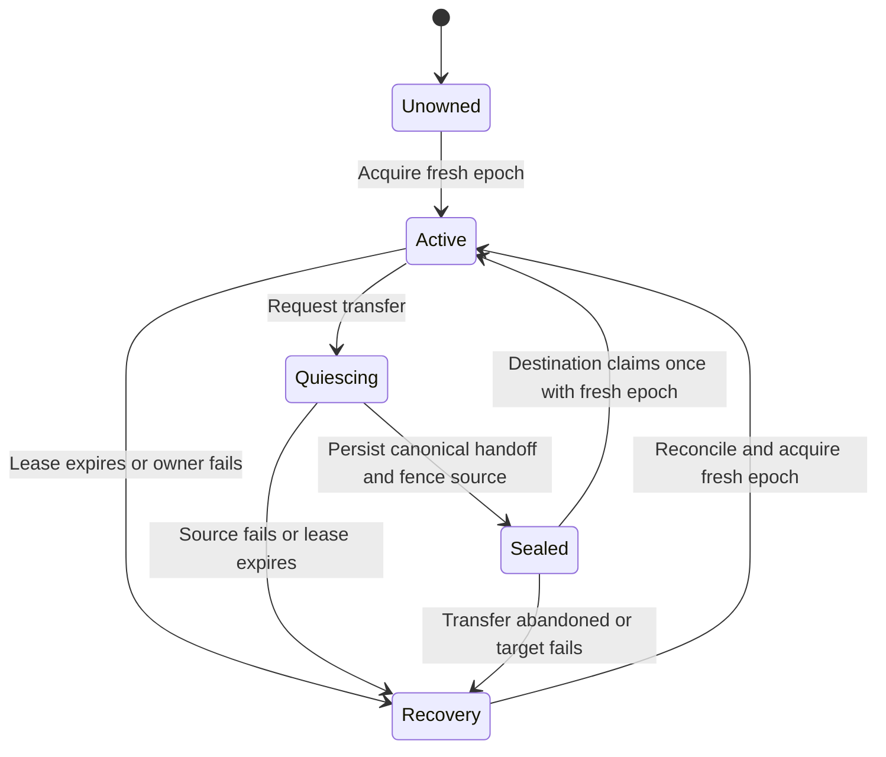

# Online architecture decision

October 18, 2026 · Step 02 · Task ID: `online-architecture-decision`

Status: selected engineering baseline, subject to implementation proof. This
document defines requirements for later code. No network service, account system,
database, or multiplayer gameplay has been implemented or deployed in this step.
Confirmed product scope remains in `GAME_SPEC.md`.

Implementation update, October 21, 2026: PUBLIC_STORAGE_PROOF.md completes the
isolated pre-Step-35 PostgreSQL/service dependency proof with synthetic accounts,
concurrent requests and real process-crash recovery. This does not implement
public identity, leased server trust, internet hosting or gameplay persistence.

## Modes and trust boundaries

| Mode | Simulation authority | Durable state | Identity |
| --- | --- | --- | --- |
| Our public dedicated session | An operator-approved headless Godot server with temporary account leases | Central account/economy service and PostgreSQL | Signed-in public account |
| Player-hosted session | Host's Godot process, including its local player | Host-owned world save; isolated SQLite database | World-scoped guest identity |
| Local development/test | Same host-authoritative rules with fixtures | Separate test namespace/files | Test or private guest identity |

Both multiplayer modes are required. A publicly listed player host remains a
private-economy world. A dedicated process is not trusted for public progression
merely because it is headless or appears in the directory: the public backend
must explicitly authenticate and authorize its server instance.

Clients send intent, such as helm input or a delivery request. The authority
validates identity, ship control, compatibility, quantities, timing, and state.
Clients never set balances, declare cargo delivered, submit final authoritative
positions, or upload ownership snapshots. Prediction and presentation cannot
commit durable outcomes. The host's local player uses the same request path.

## Selected providers, storage, and transport

These are engineering choices for the implementation path, not additional
user-confirmed product requirements:

- **Public identity:** self-hostable Keycloak using OpenID Connect (OIDC), with a
  stable provider subject mapped to our internal account UUID. Use issuer plus
  subject as the identity key; names/email addresses are mutable display fields.
- **Public persistence:** one authoritative HTTPS account/economy service backed
  by PostgreSQL. Its transaction boundary contains account state, fleet/cargo/job
  ownership, operation receipts, leases/transfers, market state, and refinery
  stocks/processing. Game clients and Godot servers receive no direct database
  credentials. Keycloak's own records use a separate database/role.
- **Private persistence:** one versioned SQLite database per world on the host,
  containing members, progression, fleet/cargo/jobs, local market/refinery state,
  and operation receipts. The host is its only writer. godot-sqlite v4.9 is pinned
  and tested on Windows x64; STORAGE_PROOF.md records process-kill, migration,
  backup/restore evidence and the cold-import workaround. Production concurrency,
  authority and hardware durability still require their later proofs.
- **Game transport:** Godot high-level multiplayer over ENet/UDP; a player host
  and a headless dedicated server use the same authoritative gameplay layer.
  Separate control requests, state updates, and receipts into suitable channels
  during the networking prototype. Choose rates from measurements.
- **Transport authentication:** use ENet's DTLS support with validated server
  identity before sending join/reconnect credentials. Public endpoints use
  approved certificates; private worlds use a per-world certificate whose
  fingerprint is confirmed by an invitation/direct-connection trust flow or a
  signed directory record. Bind public tickets to that server identity. Do not
  silently disable certificate validation. Prove this integration before online
  identity use; developer-only insecure loopback fixtures cannot access production.
- **Service transport:** HTTPS for identity, directory, join tickets, persistence,
  and server-to-backend requests, with scoped server-instance credentials.

No provider is installed, account created, hosting purchased, or production
version pinned here. Pin supported component versions when building the services.
The service's programming language and deployment host are implementation choices
that do not change these authority/storage boundaries. Change a selected provider
through a recorded decision and migration plan rather than silently replacing it.

## Public accounts and private guests

Public persistent play requires sign-in. Public anonymous/guest accounts are not
part of this baseline; guest play is available in player-hosted/local worlds.
Use the system browser with authorization code + PKCE (S256), state/nonce
validation, and a loopback callback bound only to `127.0.0.1` on Windows. The
native client has no embedded client secret and does not collect passwords.
Validate issuer, audience, signature, and token expiry at the service. Persist
refresh credentials only through a validated OS credential store; until that is
available, keep them in memory and ask the player to sign in again after restart.

After sign-in, the backend issues a short-lived, single-use join ticket bound to
the account, intended server instance, protocol, expiry, and a connection nonce.
The server redeems it through the backend; possession of the ticket alone does
not grant an ownership lease. Long-lived identity tokens never go to a player
host. Account recovery belongs to the identity provider; identity linking must
not merge public wealth from client or private-world files.

For a new private-world guest, the host generates `private_player_id` and a
random reconnect credential. It persists the credential hash with the member;
the client stores the credential scoped to `world_id` and that world's trusted
server identity. Reconnect proves possession over the authenticated channel and
replaces any old connection for that member. Display names and Godot peer IDs
cannot recover or claim saves. Losing the credential means a new guest unless
the host explicitly restores access; there is no automatic name-based recovery.
Private-world credentials cannot authenticate to public services or another world.

## Ownership and save rules

| State | Our public sessions | Player-hosted worlds |
| --- | --- | --- |
| Money, owned ships, customization, fuel/condition, cargo/jobs, recovery balance | Backend canonical records tied to account and stable IDs | Host database keyed by world and private member |
| Oil prices and trades | Shared public market; port-specific records/quote versions, same history across public servers | Independent market in that world |
| Refinery stocks and processing | Shared stable public facility IDs, durable processing/withdrawal operations | Independent world inventory and processing |
| Live helm/physics and nearby replication | Current leased server; state is validated and checkpointed | Current host |
| Map scenery | Rebuilt/streamed from definitions; not ownership evidence | Same separation |
| Offshore heavy jobs | Scope explicitly deferred to job-system design; no implicit global sharing | World-local unless later designed otherwise |

Every public persistent change carries an operation ID, request hash, account,
server instance, lease epoch, and expected state/quote revisions where relevant.
The service validates the current lease and locks affected records in the same
database transaction as the resource changes and durable receipt. Lock records
in a defined order or use serializable transactions with bounded retries. A
market/refinery action must atomically include both shared stock/quote effects
and account effects; do not split debit and delivery across independent stores.
Multi-account work must validate every affected account's authority/reservations.

The request hash covers immutable business intent, excluding transport context
such as the current server instance, lease epoch, or connection nonce. Authenticate
the current requester separately so a new valid owner can reconcile the original
operation after handoff without changing its identity.

Replaying the same account/operation ID and business payload returns the recorded result;
the same ID with a different payload is rejected. A committed receipt survives
restart and server transfer. Retain receipts/tombstones across the permitted retry
window so pruning cannot turn an old request into a new reward. A lost reply
means query/retry the same ID, not create another operation or guess a refund.
Public processing workers use scoped service identities and unique durable job
IDs; account disconnection cannot restart refinery production or double-credit it.

Report an economic outcome as accepted only after its durable commit. Persist
critical cargo loss, recovery charges, purchases, and delivery outcomes together
with their receipts. Pending UI messages are not confirmations. Periodic motion
checkpoints may lose motion since the last checkpoint after a crash; tune and
display this boundary when saves are implemented. Snapshot writes only update
their owned simulation fields and expected revision; they cannot overwrite newer
wallet/cargo operations with a stale whole-profile save.

Private hosts apply equivalent atomic operation/receipt rules in their local
database. A host may modify its own files; no result or backup from that trust
domain can authorize public imports. Exported private saves stay private.

## One active public account session

The backend owns one lease row per account:
`account_id`, `owner_server_instance`, `epoch`, `state`, `expires_at`, and
`state_revision`. Server instance IDs change on process restart. Epochs increase
monotonically on ownership replacement; an old epoch is never made valid again.

Acquisition/renewal compares and changes the row transactionally using backend
time. A proposed starting lease is 30 seconds, renewed every 10 seconds; these
are tuning defaults, not correctness assumptions. Each persistent write checks
the owner, epoch, state, and expiry while holding the lease lock together with
the affected state locks. Bound transaction duration. This serializes competing
renewals/acquisitions and prevents a separate precheck/write race. The backend
must reject expired-lease renewals; recovery acquires a fresh epoch instead.

The game server maintains a conservative monotonic local stop deadline and
quiesces affected ships when renewal fails, a commit becomes uncertain, storage
becomes unavailable, or ownership becomes invalid/uncertain:
stop helm requests, cargo actions, damage/economic changes, and interactive
collision participation. The stale instance cannot continue consequential
simulation. A later database check still fences all stale writes. No public
wealth accrues offline waiting to be merged.
Ordinary business rejections, such as insufficient funds or a stale quote,
return a clear rejection and do not freeze an otherwise valid session.

A second login cannot take an active lease. Reconnecting to the current owner
requires a fresh valid ticket and atomically replaces the old client binding;
use a connection generation so delayed packets from the old connection fail.
After expiry or a failed owner, backend recovery fences the prior epoch and
loads only canonical state before assigning a new owner. Clients do not choose
which competing snapshot wins. Respawn placement cannot silently deliver cargo,
reset condition, or waive an already committed recovery charge.

## Durable public-server handoff

1. Authenticate the player and preflight the destination's build/capacity and
   public-server authorization. Source retains authority until quiescing begins;
   concurrent switch requests share one backend transfer record.
2. Source stops new actions and settles/query-reconciles in-flight operation IDs.
   Persist resumable long operations and reservations explicitly; wait for or
   durably cancel non-transferable ones. Active refinery processing remains a
   durable backend job, not a reason to recreate cargo on arrival.
3. In a transaction holding the lease/state locks, seal the canonical location,
   owned-ship/cargo/job references, operation frontier, and state revision. Create
   a transfer ID bound to the destination and expiry, and revoke/fence source
   authority. Late old-epoch saves or actions cannot commit. Seal cannot proceed
   with unresolved non-durable accepted outcomes.
4. Destination redeems a fresh ticket and atomically claims the sealed transfer
   once. It acquires a new epoch and loads the exact canonical revision. Spawn
   only after that commit. Cargo/ships/jobs retain their IDs. The client carries
   only connection/transfer references, never an authoritative snapshot.
5. Retrying claim or querying transfer status returns the existing outcome rather
   than acquiring twice. A destination crash after claim requires lease recovery,
   not a second uncontrolled spawn. A failed pre-seal transfer can resume source
   control only if its lease is still current; after seal, cancellation/timeout
   goes through backend recovery with a fresh epoch and preserved state.

Backend expiry/recovery processes handle abandoned transfers. Neither a source
crash nor lost client response grants permission to reissue a reward, reset
inventory, or restore an old source lease. Source crash before seal resumes from
the last durable state and reconciled receipts. Motion checkpoint limits apply;
accepted cargo/money effects remain durable. Sailing between scenery regions,
through the longitude seam, or around the globe never triggers a server handoff.
The exact spatial payload waits for the world-coordinate prototype.

## Departure, outages, directory, and capacity

**Private host departure:** graceful exit stops new requests, commits the local
world consistently, sends closure, then disconnects clients. Commit failure is
shown as unsaved progress, not a false success. Host crash ends the session;
restart restores the last valid committed state with schema/backup checks.
Clients cannot continue a replacement world or promote their caches. No host
migration is required for version 1. In-progress operations resume or cancel
through their durable IDs when those systems are implemented.

**Public failure:** backend/database unavailability blocks new public joins,
transfers, and persistent actions; affected simulation quiesces as described
above. Do not create a per-server fallback oil history or mint local wealth.
Graceful server shutdown drains actions, commits, and releases leases or performs
valid handoffs. A crash follows expiry/recovery. A public-server disconnect ends
control, not ownership of saved ships. A coordinated database restore must restore
state, receipts, jobs, leases, and transfers consistently, invalidate prior server
credentials/lease generations, and reconcile before reopening public sessions.

**Directory:** versioned registration, heartbeat/expiry, list, and endpoint data.
Show name, population/capacity, protocol/build compatibility, session/economy type,
and status/latency where measurable. Approved public-server registration uses
operator credentials; player-host registration cannot self-label as public economy.
Private/unlisted sessions are absent from public queries. Refresh, clear join
errors, and direct connect remain required. Directory outage prevents fresh list
updates, not ongoing valid sessions or validated direct connections. Initial
reachability proof is direct LAN/UDP; internet NAT/relay path and invitation UI
are deployment decisions that must be tested before promising easy internet host
access. Directory presence alone does not make a residential host reachable.

**Capacity:** benchmark at 2, 10, 25, 50, and approximately 100 clients, including
crowded ports, dispersed ships, joins/reconnects, and concurrent transactions.
Record client/server frame times, CPU/memory, bandwidth, storage latency, and
motion quality. Interest filtering and controlled cargo attachments are starting
techniques, not proof. No configured peer limit demonstrates supported capacity.

## Required implementation proofs

These checks are assigned to later implementation steps; none ran in Step 02.

| Proof | Passing result |
| --- | --- |
| Host/client and dedicated smoke tests | Both apply the same validated rules; dedicated server is not a player. |
| Identity/admission | Invalid/expired/replayed tickets fail; private guest spoofing and old connections cannot claim another save. |
| Isolation | Private save import and listed-host attempts cannot change public balances, fleet, market, or refinery stock. |
| Atomic/replayed operations | Concurrent trade/withdrawal, lost replies, payload mismatch, and restart preserve quantities and one outcome. |
| Lease fencing | Two logins, expiry during a write, delayed renewal, and a returning stale server never create two committing owners. |
| Transfer fault matrix | Crash/disconnect before seal, after seal, after claim, duplicate claim, and abandoned destination preserve canonical ownership and receipts. |
| Backend outage/restore | No fallback public economy; affected simulation stops; restore rejects all old authority and reconciles state. |
| Private durability/departure | Crash during commit restores a consistent state; graceful exit is truthful; host loss ends clients' session. |
| Public internet/capacity | Real connection-path and load evidence determines supported configuration. |

Identity and public handoff runtime work belongs to the later roadmap tasks,
including Steps 40–41; provider/binding feasibility and save contracts must be
checked earlier before durable economy code. Component versions, service language,
deployment, NAT/relay selection, guest recovery UX, and numeric timeout/checkpoint
tuning remain implementation tasks, without reopening the confirmed two modes.

## Primary references checked October 18, 2026

These establish available building blocks. The authority, lease, handoff, and
failure rules above are our design and still need implementation verification.

- [Godot 4.7 high-level multiplayer](https://docs.godotengine.org/en/4.7/tutorials/networking/high_level_multiplayer.html): ENet/UDP, authority/RPC behavior, and hosting considerations.
- [Godot 4.7 dedicated export](https://docs.godotengine.org/en/4.7/tutorials/export/exporting_for_dedicated_servers.html): headless/dedicated build path.
- [Godot 4.7 ENetConnection](https://docs.godotengine.org/en/4.7/classes/class_enetconnection.html): DTLS client/server setup and certificate validation.
- [Keycloak OIDC](https://www.keycloak.org/securing-apps/oidc-layers): identity flow and endpoint support.
- [RFC 8252: OAuth for native apps](https://www.rfc-editor.org/rfc/rfc8252.html): external browser, PKCE, and loopback redirect pattern.
- [PostgreSQL transaction isolation](https://www.postgresql.org/docs/current/transaction-iso.html) and [row locking](https://www.postgresql.org/docs/17/explicit-locking.html): transactional concurrency primitives; our application must enforce its invariants.
- [SQLite atomic commit](https://www.sqlite.org/atomiccommit.html): local transaction durability model and platform assumptions to verify.

## Authentication feasibility evidence — October 21, 2026

AUTHENTICATED_ADMISSION_PROOF.md documents the completed component gate and D072
transport adapter. Player-facing browser login and integrated admission/gameplay
ownership remain Steps 40–41; the pre-42 two-server acceptance gate still applies.

## Step 40 implementation — October 21, 2026

PRIVATE_SESSION_IDENTITY.md records the integrated private-world path: stable
membership, verified DTLS invitations, generation-fenced helm/cargo control and
fresh-process host recovery. Client credentials are memory-only. Public OIDC
service admission and durable leases/handoff remain Step 41 and the pre-42
integration gate; no private-world progress can be imported as public state.

## Step 41 adapter evidence — October 22, 2026

PUBLIC_PROFILE_HANDOFF.md records transactional public profiles, lease/connection
fencing, scoped ticket admission and durable transfer recovery through PostgreSQL
and HTTPS. The fixture uses synthetic account enrollment and separate Python
server-adapter processes. Validated OIDC ticket issuance and live Godot server
quiescing/spawn integration remain the next pre-42 gate; no public deployment or
playable dedicated-server launcher is claimed. D074 records the lease decisions.
